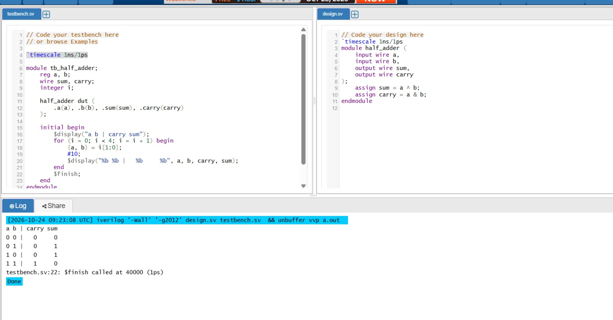
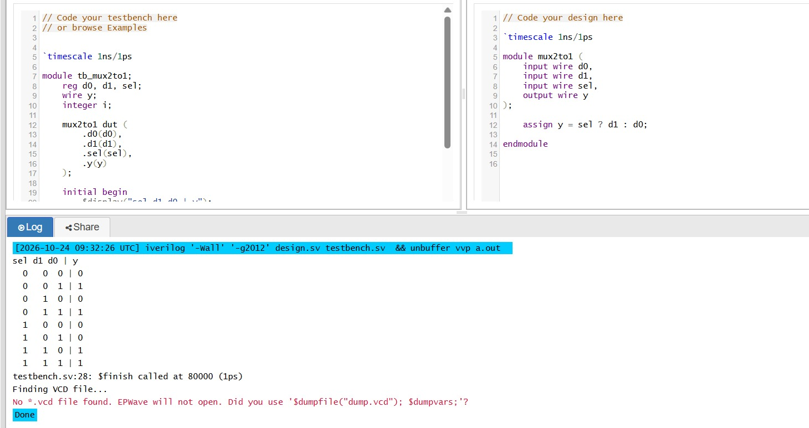
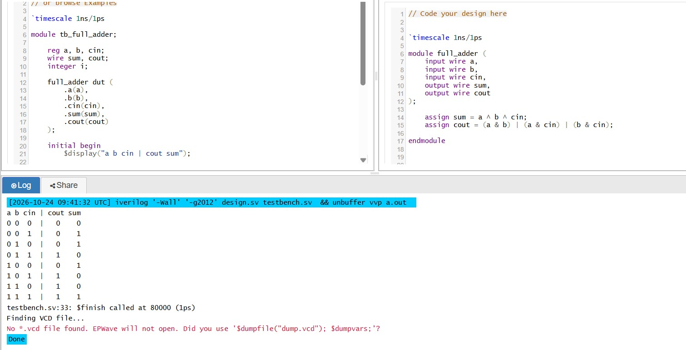

# Simulation Results

This folder contains simulation evidence for my Verilog RTL designs.

## Half Adder
- Simulator: Icarus Verilog 12.0
- Verification: All four input combinations checked.
- Result: Output matches the expected half-adder truth table.
-

## 2:1 Multiplexer

- Simulator: Icarus Verilog 12.0
- Verification: All eight input combinations checked.
- Result: Output matches the expected multiplexer truth table.
- 

## Full Adder

- Simulator: Icarus Verilog 12.0
- Verification: All eight input combinations checked.
- Result: Sum and carry outputs match the expected full-adder truth table.
-
