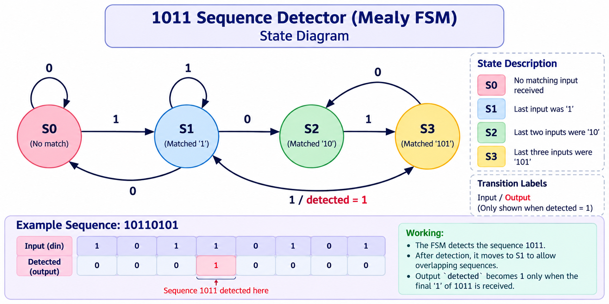

# 1011 Sequence Detector — Mealy FSM

## Overview

This project implements a Finite State Machine (FSM) in Verilog HDL to detect the serial input pattern 1011.

## State Diagram

The state diagram illustrates how the FSM transitions between states as each input bit arrives.

## State Descriptions

- S0: No matching input received.
- S1: The last input was 1.
- S2: The last two inputs were 10.
- S3: The last three inputs were 101.

## Detection

The output detected becomes 1 when the final bit of the sequence 1011 is received.

## Tools Used

- Verilog HDL
- EDA Playground
- Icarus Verilog

## Verification

The design was simulated using a Verilog testbench with the input sequence 10110101.
